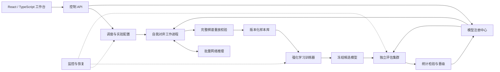

# AlphaGo Zero 系统完整技术方案

> 用户提供的 2026-11-23 设计基线。文中“当前实现”、历史测试与示例运行均沿用原方案语境。本目录的交付范围和验证记录见 [开发阶段表](development-roadmap.md)。

版本：1.0；基准日期：2026-11-23。本文整理已经约定的完整方案，并说明当前实现与目标架构之间的差异。开发执行顺序见 [开发阶段表](development-roadmap.md)。

## 1. 目标、范围与成功标准

建设一套从随机参数开始，通过自我对弈产生数据、持续训练、独立评估和模型迭代提升棋力的围棋强化学习系统。最终面向 19×19 围棋，并以可复现的公开前沿竞争为长期研究目标。

| 层次 | 目标 | 成功标准 |
| --- | --- | --- |
| 算法基线 | 策略价值网络、MCTS、自我对弈、训练、评估闭环 | 规则与搜索正确，多种子实验显示相对初始模型的提升 |
| 持续训练平台 | 数据归档、分布式采样、恢复、晋级、回滚、监控 | 长期稳定运行，模型与数据来源可追溯 |
| 前沿研究 | 现代网络、搜索改进和数据效率优化 | 在固定硬件、规则和用时下，对强公开模型取得有统计依据的结果 |

从零开始指自主实现核心系统、随机初始化训练权重，主训练数据由自身对弈产生。允许使用 PyTorch、CUDA、通信与存储基础设施。外部引擎用于规则交叉验证和棋力评估，其棋谱与预测不自动进入主训练集。

维护两类实验：`agz_reference` 用于经典方法对照，逐项登记偏离论文之处；`research` 用于辅助任务、现代架构和搜索改进。当前 9×9 工程实现不等同于严格论文复现。

完成软件闭环可以设定工程期限；达到国际前沿不能预先承诺。以当期多个强公开模型构成可复现基准，不能将公开比赛结果外推到所有未公开系统，也不使用跨平台绝对 Elo 作为证明。

截至本方案资料核查日期，KataGo 已公开支持 Transformer 的模型和持续训练流程。因此前沿路线保留网络替换能力。[官方发布](https://github.com/lightvector/KataGo/releases/tag/v1.17.0) · [训练进展](https://katagotraining.org/)

## 2. 整体架构与技术选型



| 模块 | 职责 | 当前实现 | 目标演进 |
| --- | --- | --- | --- |
| 规则引擎 | 合法性、提子、气、超级劫、计分 | C++20 / pybind11 | 增量棋串、撤销栈与内存优化 |
| 搜索引擎 | PUCT、回传、访问统计、树复用 | Python 调度原生棋盘 | 原生并行搜索与多局批量推理 |
| 网络与训练 | 共享主干、损失、优化、检查点 | Python / PyTorch | 混合精度、DDP、现代主干 |
| 数据层 | 重放校验、样本分片、来源与校验和 | 本地 NPZ、JSON、SGF | 对象存储、版本化清单与窗口索引 |
| 控制层 | 任务启动、停止、续训、版本管理 | FastAPI、子进程、文件锁 | 持久任务租约、调度器、元数据数据库 |
| 评估层 | 成对比赛、统计报告、晋级 | 独立模型与搜索树 | 专用评估工作池和历史联赛 |
| 前端 | 对弈、训练进度、模型、比赛报告 | React / TypeScript / Vite | 集群与实验对比视图 |

初期模块在同机运行，协议与职责保持独立。集群阶段使用已有 Slurm 或 Kubernetes 环境；不要将复杂集群基础设施作为第一个闭环的前提。

## 3. 围棋规则与状态语义

第一套规则固定为 Tromp–Taylor 加白贴 7.5 目：面积计分、位置超级劫、连续两次停着终局。落子后先清除对手无气棋串，再清除己方无气棋串；允许符合超级劫约束的多子自杀。不自动推测或删除死子。[规则原始定义](https://tromp.github.io/go.html)

完整状态包含棋盘、行棋方、连续停着数、历史重复局面集合、规则配置及特征历史。网络只观察有限历史，但合法性检查使用完整历史。停着独立处理，不能因为棋盘不变而被超级劫禁止。

位置超级劫比较棋盘颜色分布，不将行棋方加入键。当前采用精确字节串；未来使用 Zobrist 哈希时必须有碰撞处理。状态推进支持分支复制，后续替换为增量更新与可靠撤销。

终局空域仅接触一种颜色时归该方；接触双方或不接触任何棋子时中立。计分为棋子数加归属空点数，白方另加贴目。胜负标签必须来自真实规则终局。

达到程序看门狗步数上限的棋局是未完成样本，不得强行按当前估值判胜负。中国、日本及让子规则作为独立规则版本后续实现，不能仅改显示名称后混用训练数据。

规则验收包括捕获、自杀、劫、非局部超级劫、双活、中立空域、停着、终局和恢复；与独立慢速实现进行随机合法对局逐步比较。

## 4. 神经网络

共享主干输出策略和价值：`(pθ(s), vθ(s)) = fθ(s)`。策略包含所有交叉点及停着；价值从当前行棋方视角表示预期终局结果，范围为 `[-1, 1]`。

经典输入为最近八个局面的己方、对方棋子平面和颜色平面，共 `17 × N × N`。固定规则与贴目写入模型元信息；多规则或多贴目训练时显式增加条件输入。

```text
输入 → 3×3 Conv + BatchNorm + ReLU
     → B 个残差块（每块两层 3×3 卷积）
     → 策略头：N²+1 个 logits
     → 价值头：tanh 标量
```

| 网络档位 | 棋盘 | 建议规模 | 作用 |
| --- | --- | --- | --- |
| 当前快速闭环 | 9×9 | 2 块 × 32 通道，58,205 参数 | 本地流程与交互 |
| 调试基线 | 9×9 | 6 块 × 64 通道 | 算法与学习稳定性验证 |
| 工程模型 | 19×19 | 10 块 × 128 通道，约 330 万参数 | 吞吐与成本校准 |
| 标准基线 | 19×19 | 20 块 × 256 通道，约 2400 万参数 | 长期学习曲线 |
| 容量实验 | 19×19 | 40 块 × 256 通道，约 4800 万参数 | 模型扩容收益研究 |

9×9 棋力不能替代 19×19 验证。正式 19×19 基线从随机参数独立初始化；任何迁移或蒸馏都单列实验来源。

执行 D4 旋转与镜像增强，棋盘历史、策略、合法掩码和辅助标签同步变换，停着不变。训练与推理明确切换 BatchNorm 模式；导出后检查输出和棋力一致性。

研究版依次增加胜和负分布、终局分差、终局归属图及预测误差头。标签来自规则和自身对局；认输对局没有完整归属或分差，必须屏蔽相应损失。辅助头收益通过消融验证。[KataGo 研究](https://arxiv.org/abs/1902.10565)

Transformer 候选以交叉点为 token，加入二维位置信息，起始探索 10–12 层、384–512 隐藏维度、6–8 注意力头；保留逐点策略和全局价值输出。这是待实验设计，不是对已有引擎架构的精确复刻。

## 5. MCTS

每条边保存先验 `P`、访问次数 `N`、价值和 `W`，以及 `Q=W/N`。选择合法动作使下式最大：

```text
Q(s,a) + c_puct · P(s,a) · sqrt(sum_b N(s,b)) / (1 + N(s,a))
```

初始化访问、未访问动作价值和并列选择必须明确。当前工程版在平方根内使用 `1+sum N` 避免初始探索项为零，并以随机种子控制并列选择。

一次模拟：选择路径 → 规则推进 → 非终局叶节点网络估值／终局真实结果 → 展开合法先验 → 沿路径回传。每跨一个回合价值取反，边 Q 按父节点行棋方视角保存。没有随机 rollout。

训练根噪声为 `P'=(1-ε)P+εη`，`η~Dirichlet(α)`。当前 9×9 使用 `ε=0.25, α=0.12`；19×19 初始实验使用 `α=0.03`。噪声只影响本次根探索，不污染保存的干净先验。

| 项目 | 当前 9×9 | 19×19 起始规划 |
| --- | --- | --- |
| 每步新增模拟 | 快速配置 8；一般小实验 16 | 调试 128–256，正式 800；论文对照 1600 |
| c_puct | 1.5 | 1.5 起步，通过实验调整 |
| 落子温度 | 前 20 手 1，随后 0.1 | 前 30 手 1，随后趋近 0 |
| 训练目标 | 累计根访问次数归一化 | 同口径，改动需版本化 |
| 评估行为 | 无根噪声，最大访问动作 | 同口径，固定时间评测为跨引擎主指标 |

训练目标与落子温度分离：`π(a)=N(a)/sum N`，实际动作可按 `N^(1/τ)` 采样。论文复现配置单独维护其约定。

保留落子后的对应子树。不同网络的搜索树与统计独立；相同棋盘但不同超级劫历史不能随意合并。网络缓存可以复用完整输入对应的原始输出，合法性仍在当前完整状态上计算。

并发优先让多局共享推理批次；单树并发使用预约或虚拟损失，并在取消、超时和异常时撤销临时统计。

## 6. 自我对弈与数据契约

每盘棋固定模型摘要、规则版本、搜索配置和随机种子，新版本只在新对局生效。每步保存状态特征、行棋方、合法掩码、实际动作、访问次数、搜索价值及预算。终局补写各步行棋方视角的 `z`。

当前关闭认输。未来开启时保留随机抽样的不认输对局，估计错误认输率；按置信上界决定是否扩大使用，不通过固定经验阈值直接假定安全。

入库前完整重放棋谱并核验输入、策略、访问计数、合法性和终局。文件完成写入与校验后再提交清单，损坏或不完整数据隔离。当前使用 uint8 特征和压缩 NPZ，保留 JSON 来源与 SGF。

数据分层：不可变归档、可调训练回放窗口、独立评估数据。评估棋谱不自动进入训练。训练／验证按完整对局分组，避免相邻局面泄漏。重复数据按模型、种子、搜索配置、动作和访问统计生成内容标识去重。

当前窗口默认 2 万局面；长期实验根据采样速度扩展到百万级以上。监控数据年龄、重复比例、采样分布和棋力遗忘，而非只增大窗口。

## 7. 强化学习与恢复

基础目标：

```text
L = E[-sum_a π(a|s) log pθ(a|s) + λv (vθ(s)-z)²] + λ2 ||θ||²
```

策略交叉熵在合法动作空间计算。工程版对矩阵参数显式施加 L2，优化器不重复施加相同正则；辅助头分别记录损失和梯度规模。

| 项目 | 当前实现 | 扩展规划 |
| --- | --- | --- |
| 优化器 | SGD、momentum 0.9 | 保留基线；其他优化器独立消融 |
| 学习率 | 默认 0.02、固定 | warmup 后按预定样本进度下降 |
| 批次 | 快速配置 16，一般 32 | 全局 1024 起步，必要时梯度累积 |
| 价值权重／L2 | 1.0／1e-4 | 用验证与梯度尺度校准 |
| 精度 | FP32 | BF16／FP16 混合精度，关键归约 FP32 |
| 稳定性 | 非有限值检查，梯度范数裁剪 5 | 校准、溢出与恢复监控 |

控制复用率 `r=训练消费样本数/同期新增有效样本数`，起始实验范围 1–4。训练速度超过采样能力时应限速或增加采样；loss 下降不等于棋力上升。

闭环为：随机初始化 → 冠军采样 → 重放校验 → 更新 learner → 冻结候选 → 独立比赛 → 按门槛发布。候选未晋级时保留冠军，但同一训练任务中的 learner 可以继续更新。

检查点保存权重、优化器、学习率所需状态、CPU／CUDA RNG、NumPy RNG、训练步数、配置及回放清单。当前续训复制源检查点并创建新运行，恢复权重、动量、随机状态；从新迭代继续，不宣称精确恢复一盘未完成棋局。CLI 本轮配置决定续训学习率；前端沿用源配置，仅改变新增轮数。

## 8. 模型评估与发布

评估覆盖固定搜索预算、固定硬件用时、累计训练成本、历史模型联赛和特殊局面。不同引擎访问数定义可能不同，跨引擎主要比较固定硬件和用时，附实际网络调用数。

模型状态：`TRAINING → CANDIDATE → EVALUATING → APPROVED → CHAMPION`，失败候选标记 REJECTED 并保留产物。

比赛关闭训练噪声，平衡执黑执白，固定模型与配置。当前使用随机六手开局，交换模型执子；每个开局对作为统计单元。当前保守门槛要求全部比赛完成、至少 40 局、得分率 ≥55%，且 95% 单侧成对 Hoeffding 下界 >50%：

```text
lower = max(0, mean(pair_scores) - sqrt(log(20)/(2 * number_of_pairs)))
```

这不是“40 局达到 55% 即晋级”。未完成比赛不计输赢，且阻止晋级。独立评估只出报告，不改冠军。发布使用期望冠军摘要的原子比较更新，防止过期比较结果覆盖新冠军。

经典工程讨论中的 800 局、55% 胜率在独立无和棋近似下对应 Wilson 95% 区间约 51.5%–58.4%；该区间不能直接替代当前成对统计。若改用序贯检验，必须预先定义停止规则；不允许反复查看普通置信区间直到显著。长期平台补充多候选选择的多重检验控制和独立确认赛。

Elo 差值在相同评估体系内按 `400 log10(p/(1-p))` 描述；55% 对应约 35 Elo。全胜或全负不报告有限 Elo 点估计。常规比赛外加入劫争、长征、双活、停着及循环包围等鲁棒性测试。[对抗鲁棒性研究](https://arxiv.org/abs/2406.12843)

## 9. 分布式训练与故障处理

自我对弈采用异步任务并行，每个节点运行多局 CPU 搜索，由本机 GPU 汇总叶节点推理。训练采用同步 DDP，每卡一个副本并显式分片数据。先使用数据并行，显存压力确有必要时才引入模型或参数分片。

| 故障／约束 | 目标处理 |
| --- | --- |
| actor 退出 | 租约到期重分配，以对局标识去重 |
| 分片上传中断 | 临时对象完整校验后提交清单 |
| learner 退出 | 从完整检查点恢复 |
| 模型发布 | 新对局使用新摘要，旧对局保持原权重 |
| 样本过旧 | 按模型年龄过滤或降权 |
| 推理积压 | 队列背压、并发限制与批次等待上限 |
| 存储不可用 | 有界本地缓存，达到阈值后有序暂停 |
| 模型异常 | 停止发布，隔离关联样本，恢复健康版本 |

初期以本地文件锁保证单计算任务；后续迁移数据库事务与持久租约。每个任务记录代码提交、配置摘要、设备、软件环境及数据清单。

## 10. 资源预算与性能优化

设完整对局数为 G，平均局长 L，每步新增模拟数 S，新网络评估比例 ρ，单卡推理吞吐 F，则：

```text
网络评估次数 ≈ G × L × S × ρ
自我对弈 GPU 小时 ≈ G × L × S × ρ / (3600 × F)
集群天数 ≈ GPU 小时 / (24 × GPU 数 × 有效利用率)
训练 GPU 小时 ≈ r × 新增有效训练局面数 / (3600 × 单卡训练吞吐)
```

假设 100 万局、250 手、800 次新增模拟、ρ=0.7、F=10000 局面/秒，则为 1.4e11 次评估和约 3889 GPU 小时。64 卡、70% 有效利用率时，仅自我对弈约 3.6 天。此处是算术示例，不是硬件实测或棋力承诺，且不包含训练、比赛和失败实验。F 若已是端到端吞吐，不重复扣减同一利用率损失。

| 阶段 | GPU 规划 | 主机与存储起点 | 用途 |
| --- | --- | --- | --- |
| 单机验证 | 1 张，24–48 GB 显存；小闭环可用 CPU | 16–32 核、64–128 GB RAM、1–2 TB NVMe | 验证闭环与 19×19 工程调试 |
| 正式研发 | 4–8 张 | 每节点 32–64 核、128–512 GB RAM、本地缓存 | 基线与消融 |
| 长期研究 | 可扩展至 64–256 张 | 搜索 CPU、对象存储、高速训练网络 | 多实验与前沿竞争 |

19×19 的 17 个 FP32 特征平面加 362 维策略约 26 KB/局面；一亿局面约 2.6 TB，未计其他字段。位压缩、整数计数和分片压缩以 1–3 KB/局面作为待实测目标，同时预算归档和副本。

扩容前安排 24–72 小时基准测量：推理吞吐、局长、完整棋局/秒、训练吞吐、缓存命中、CPU 占用和排队时间。按瓶颈分配采样、训练与评估资源。

优化顺序：多局批量推理 → 规则与搜索热路径 → 树与推理缓存 → 精度、编译与算子优化 → 数据效率 → 集群扩容。评判指标是单位累计资源带来的棋力改善。不同网络实测比较 CUDA/cuDNN 与 TensorRT，不能假定某个后端总是最快。

## 11. 前端交互与可观测性

React 工作台包含对弈实验室、自主训练、模型仓库和评估竞技场。界面必须绑定真实 API 数据，明确随机模型、训练候选和评估充分性，不能伪造训练进度或棋力。

支持固定模型对局、执子选择、AI 回应、分析分布、悔棋、回看、SGF 导出；训练支持配置、阶段、曲线、日志、停止与检查点续训。报告可以导出，错误需要指出可采取的操作。当前交互棋局为内存会话，训练产物持久保存。

监控非法动作、计分差异、非有限数值、梯度、样本年龄、复用率、认输错误、比赛退化、GPU 吞吐和任务成本。自动化只在既定规则内执行恢复、限流和发布；改变奖励、架构和搜索方法通过版本化实验进入系统。

## 12. 研究路线与验收原则

依次研究搜索预算随机化、策略目标修剪、辅助预测、全局信息聚合／Transformer、Gumbel 搜索、历史对手与对抗训练，以及不确定性驱动的搜索预算。每次实验只引入可归因改动，重要结果使用多个独立种子与相同资源条件复验。[Gumbel AlphaZero](https://openreview.net/pdf?id=bERaNdoegnO)

自身历史模型蒸馏或扩容必须记录来源，且公平比较数据和资源条件。保持开发集与最终评估隔离。工程正确性、持续运行可靠性、学习效率、比赛棋力和鲁棒性分别验收。

当前用户要求后续集中测试。因此本次文档中的验收标准是未来执行门槛，不代表本轮已执行。实际状态以 [开发阶段表](development-roadmap.md) 和 [验收清单](verification-plan.md) 为准。
