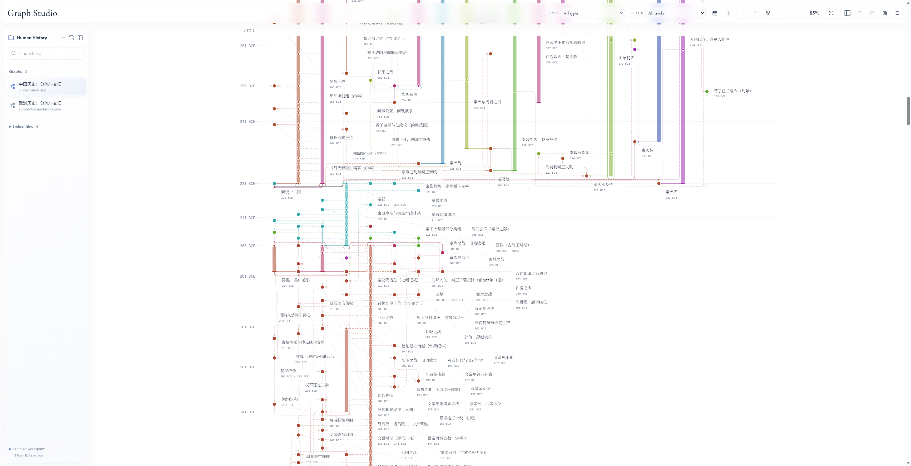
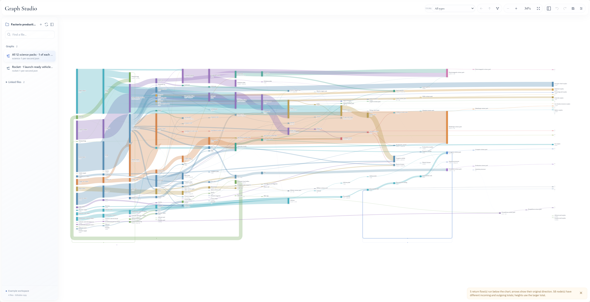

# Graph Studio

Graph Studio is a browser-based graph viewer and lightweight JSON editor for directed graphs, nested graphs, Sankey diagrams, event timelines, and spatial coordinates.

It is built for fast graph inspection and editing in the browser:

- load a JSON graph and render it immediately
- validate versioned graph documents before opening
- navigate by root, subtree, or parent level
- explore and edit arbitrarily nested subgraphs with the independent Nested node-link chart type ([guide](docs/charts/compound.md))
- explore events on calendar or relative time axes, with branching, duration bars, track filtering, and editable event times ([guide](docs/charts/timeline.md))
- edit nodes and relationships directly in the UI
- batch graph edits from a text console in `Edit` mode
- undo and redo graph mutations without losing navigation history
- save the updated graph back to JSON or export the current view as SVG
- export the current canvas as a standalone interactive HTML file with read-only node details





## Quick Start

### Interactive HTML export

Open **Settings → Files → Export interactive HTML** after a graph has rendered. The single HTML file contains the current view's layout, styles, visible node fields and visible relationships. It opens without Graph Studio or a network connection and has no app toolbar, workspace explorer or console.

- Click a node to select it; double-click, press Enter or choose **Node details** to open its detail page.
- The detail page includes Markdown fields, formulas, raw JSON and links to related nodes in the exported view. Escape returns to the canvas.
- Drag to pan, scroll or pinch to zoom. With the canvas focused, use `+` / `-` to zoom, arrow keys to pan and `0` to fit the complete exported view.

The export is a read-only snapshot: filtered nodes, nodes inside collapsed groups, linked workspace files and embedded images are not bundled. Expand groups before export to include their nodes. Group containers retain their displayed title and can be selected, but their layout cannot be expanded or edited in the exported file. External references remain links; opening them requires a connection. Fonts use the recipient's installed fonts.

For development, `/browser-tests/loading.html` serves an isolated regression fixture through Vite, covering deferred Markdown/math rendering, empty-file previews and export snapshots without opening local user files.

### One-click startup (Windows / macOS)

- **Windows:** double-click [`launch.cmd`](launch.cmd), or run it from any directory. [`launch.ps1`](launch.ps1) selects Node.js 22.12+, including an existing Codex runtime, and skips older installations on PATH.
- **macOS:** install Node.js 22.12+ including npm, then double-click [`launch.command`](launch.command). If copied from Windows or an archive without executable permissions, run `chmod +x launch.command` once. You can also run `bash launch.command` in Terminal. Homebrew installations in `/opt/homebrew` and `/usr/local` are detected.

Both entry points use [`scripts/launch.mjs`](scripts/launch.mjs) to install and verify dependencies, start the app, and open your browser. They work from any directory and do not require files outside this project. The server listens on `127.0.0.1` only. Keep the terminal window open; press `Ctrl+C` to stop. The first launch requires internet access. Do not copy `node_modules` between Windows and macOS.

On both platforms, npm is preferred; when npm is missing, the launcher imports `package-lock.json` into a local pnpm lockfile and installs with pnpm. Successful installations are fingerprinted and verified on every launch, including the native esbuild binary. Changes to dependencies, runtime, platform, or install configuration trigger a reinstall. `package-lock.json` is the authoritative lockfile; generated `pnpm-lock.yaml` is ignored. Close running Graph Studio servers before updating dependencies, and run only one dependency installation at a time.

Windows startup options:

```powershell
.\launch.cmd -InstallOnly  # Prepare dependencies without starting the server
.\launch.cmd -BuildOnly    # Check TypeScript and build the app
.\launch.cmd -NoBrowser    # Start without opening a browser
.\launch.cmd -Preview      # Build and serve the production app
.\launch.cmd -Help         # Show options
```

Equivalent macOS options:

```bash
bash launch.command --install-only
bash launch.command --build-only
bash launch.command --no-browser
bash launch.command --preview
bash launch.command --help
```

Development mode is the default (`-Dev` / `--dev`). Select only one of development, install-only, build-only, or preview; `-NoBrowser` / `--no-browser` can be combined with a server mode.

From the repository root, `.\launch.cmd graph-studio` uses the same launcher (and accepts the same options). The development server ignores `dist` so a concurrent production build does not interrupt file watching on Windows.

### Manual startup

```powershell
npm ci
npm start
```

`npm start` uses the same verified startup flow. After installing dependencies, `npm run dev` starts Vite directly for development. Node.js 22.12+ is required for all workflows.

Useful commands:

```powershell
npm run build
npm test
npm run check
```

The app starts on a welcome page. Open a graph file, open a folder as a workspace, reopen a recent location, or explore an independent example workspace:

- **Mathematics:** 112 concepts, eight subject views, and linked English notes adapted from `math/studio`.
- **Factorio production:** two demand-driven Space Age 2.0.65 Sankey plans: one complete launch-ready rocket per second, or all 12 science packs simultaneously at one of each per second. Both trace production back to raw resources.
- **Commerce operations:** nested groups and relationships across order fulfillment and returns.
- **History of Technology:** three timelines for spaceflight, mathematics and physics, and AGI research. Together they contain 804 events and phases and 1209 relationships. The English AGI canvas follows 231 point milestones and 25 duration bars across 13 research strands from 1666 to 2026, with an overview, source index and strand guides. Filter by type, track or time range.

Examples open fresh editable copies and can be reopened from Recents without folder permissions. The canvas fills the window, with the `math/studio` glass toolbar and workspace panels floating above it. Fit uses the area visible beside the panels; panning can move the graph beneath them.

Factorio values are calculated per-second material flows, including batch yields, built-in machine productivity, biological fuel, credited coproducts and catalyst/coolant returns. Surplus output is explicit. These aggregate material plans exclude power, heating, transport, spoilage in transit, construction and launch scheduling. See the [Factorio example guide](public/examples/factorio/README.md) for sources, assumptions and regeneration.

Graph documents use the strict Graph Studio v3 envelope: `format`, `version`, `nodes`, and `edges`. Custom document and edge fields live in `metadata`; node fields retain arbitrary JSON values. Legacy formats and field aliases are rejected.

## What You Can Do

- inspect and edit v3 graphs directly
- initialize a blank canvas with one starter node
- focus a node, move back through focus history, or move up to parent levels
- work with multiple roots as a forest
- switch chart type between `Node-link`, `Nested node-link`, `Sankey`, `Timeline`, and `Spatial`, each with its own saved appearance
- arrange Node-link charts with `BFS`, `Sugiyama` or `Dagre`; Sankey uses automatic flow layout
- configure node shadows in Appearance settings, with live preview and SVG export
- visualize numeric flows using the optional v3 `diagram: "sankey"` protocol ([example](public/sankey-example.json))
- inspect every node field in a generic node viewer
- edit relationships, rename nodes, duplicate nodes, or delete a node or subtree
- use the graph console for batch edits with undoable transactions
- save over the original JSON when file access is available, or download a new copy

## Documentation

- [Documentation Index](docs/index.md): chart and appearance reference library
- [Chart Types and Data Protocol](docs/chart-types.md): shared v3 contract and detailed guides for all five charts
- [Appearance and Style Protocol](docs/appearance.md): current v1 style format and chart-specific field references
- [Appearance Protocol v2 Proposal](docs/appearance-protocol-v2.md): proposed JSON-first standardization, explicitly separate from current formats
- [Workspace Guide](docs/tmp/workspaces.md): retained guide to opening modes, recent locations, discovery, and local links
- [Usage Guide](docs/tmp/usage.md): retained guide to UI workflows and editing
- [Graph Console DSL](docs/tmp/graph-console-dsl.md): retained command reference
- [Development Guide](docs/tmp/development.md): retained guide to scripts and implementation

## Minimal Example

```json
{
  "format": "graph-studio",
  "version": 3,
  "nodes": {
    "A": { "title": "Root", "type": "Concept" },
    "B": { "title": "Child", "type": "Theorem" }
  },
  "edges": [
    { "id": "edge-ab", "source": "A", "target": "B", "value": "supports" }
  ]
}
```

For the data model and chart-specific examples, see [Chart Types and Data Protocol](docs/chart-types.md).

## Project Structure

| Location | Contents |
| --- | --- |
| `launch.cmd`, `launch.ps1`, `launch.command` | Platform startup entry points |
| [`src/`](src/) | React/TypeScript source and styles; regression suites in `src/test/` |
| [`browser-tests/`](browser-tests/) | Browser-only regression fixtures, excluded from production builds |
| [`public/`](public/) | Runtime static assets, graph schema, and example workspaces |
| [`scripts/`](scripts/) | Startup, cleanup, and launcher regression tests |
| [`docs/`](docs/) | User/developer documentation and documentation images |
| Root configuration files | npm lockfile, TypeScript, Vite, formatting, and line-ending rules |

`node_modules/`, `dist/`, caches, test output, and logs are generated files and are ignored by Git. Run `npm run clean` to remove build/test output and root diagnostic logs; use `npm run clean -- --cache` to also remove local npm/example-source caches. Cleanup preserves dependencies, source, documentation, and example workspaces. See the [Development Guide](docs/tmp/development.md) for details.

## License

MIT License. See [LICENSE](LICENSE) for details.

### Spatial coordinates

The fifth Chart type, **Spatial**, renders `space: [x, y, z, …]` using dimensions and coordinate systems declared in `metadata.space`. Supports Cartesian, polar, spherical, cylindrical and geographic coordinates; 0D through arbitrary higher dimensions; Type colors/filtering; pan, zoom, orbit and projection-axis controls. Try **Spatial Atlas** for all-sky constellations, world cities, and the Beijing and Shanghai rail networks (2026-10-22 snapshots). See [Spatial guide](docs/charts/spatial.md).
