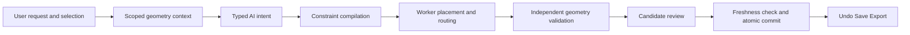

# Graph Studio AI Assisted Nested Layout and Routing

Updated: 2026-10-24. Status: initial implementation with bounded candidate search.

Graph Studio translates layout requests into typed constraints, computes geometry locally, validates each candidate, and applies accepted results as undoable document edits. AI chooses scope, direction, locks, and routing preferences. It does not supply coordinates, SVG paths, or executable code.

The implemented workflow covers scoped arrangement, locks, route-only edits, orthogonal routing preferences, candidate comparison, JSON persistence, and AI integration. Multiple ports per side, explicit sibling alignment/order constraints, strict container-boundary routing, and an ELK adapter remain future extensions.

## User Workflow

Open a graph in **Nested node-link** mode. The **Layout assistant** appears in the Subgraphs panel, including inside the workspace explorer.

1. Select a node or expanded group, or enter a group. The assistant displays the resolved scope.
2. Choose Automatic, Left to right, or Top to bottom, and Readability, Stability, or Compactness.
3. Optionally select **Only arrange connections**, **Lock selected node**, or **Allow surrounding groups to move and resize**.
4. Choose **Preview layout**. Compare both arrangements, changed objects, and quality metrics.
5. Choose **Apply layout** or dismiss the preview. Applying creates one undoable edit and marks the graph as unsaved.

The normal canvas remains committed while the preview dialog is open. SVG and interactive HTML exports therefore use the committed scene. The preview highlights moved rectangles and shows labels when edge labels are enabled.

Examples for the AI console:

- “Arrange the current group from left to right and preserve the surrounding groups.”
- “Keep the nodes fixed and route the refund connection around the outside.”
- “Lock the payment node and arrange this group vertically.”
- “Inspect the checkout group and explain its layout constraints.”

The new UI and AI explanations use English. Hosted AI requests use the configured provider; solving, validation, and manual layout work locally without a model request.

## Scope and Locks

The default scope is the selected expanded group, the selected leaf or collapsed group's visible parent, the currently entered group, or the visible root, in that order. A request never implicitly expands folded groups. External summaries are not editable members.

| Operation or constraint | Behavior |
| --- | --- |
| `layout-and-route` | Arrange visible scope members and recompute affected connections |
| `route-only` | Keep all node/container rectangles fixed; change routes and labels |
| `strict` boundary | Keep rectangles outside the scope and its container frame fixed |
| `allow-ancestor-resize` boundary | Allow affected ancestors and sibling arrangements to change; report affected groups |
| Canvas pin | Capture the current top-left canvas position for this focus, folding, and type-filter view |
| Parent pin | Capture the position relative to the visible parent container |
| `includeDescendants: false` | Move immediate child groups as rigid rectangles, preserving their internal geometry |

The root has no enclosing container, so root requests may extend the canvas. Route-only requests may add exterior lanes without changing container sizes.

Canvas pins are active only in the view where they were captured. Inactive pins remain saved and are reported in candidate warnings. Parent pins remain relative to their parent; a direct member of an entered group must use a canvas pin or be pinned from a view where its parent is visible.

Hard locks and containment never become soft penalties. Direction and port sides are preferences. Unmet preferences appear in review and disable automatic application. A bounded search failure means no solution was found within the budget, not that the graph is mathematically infeasible.

Pure layout edits do not change node fields, ordinary edges, edge direction, or containment. Regrouping continues to use graph editing.

## Architecture



The existing bottom-up layout remains the default for documents without saved layouts. Completed child groups remain fixed rectangles in their parent. The candidate solver adds scope constraints, captured locks, direction selection, and bounded alternatives. Routing runs after placement and cannot move nodes.

Candidate search uses a module Worker. The main thread measures node and label dimensions and supplies serializable data. Cancellation terminates the Worker. Initial scene generation and reapplication of saved constraints still run through the scene builder; migrating those operations is a separate performance improvement.

## Layout Protocol

| Data | Responsibility |
| --- | --- |
| `LayoutIntent` | Scope, operation, boundary policy, objective, and constraint drafts |
| `CompoundLayoutData` | Validated preferences, captured pins, and accepted snapshot |
| `LayoutSnapshot` | Top-left rectangles, route points, labels, and canvas bounds |

AI responses add `propose_layout` with `layoutProtocolVersion: 1`, and `inspect_layout`. Existing graph-editing responses remain supported. Parsers reject unsupported versions, unknown intent fields, unknown constraint types, invalid enums, and supplied pin coordinates.

```json
{
  "kind": "propose_layout",
  "layoutProtocolVersion": 1,
  "answer": "Arrange checkout horizontally and keep payment fixed.",
  "intent": {
    "scope": { "groupId": "checkout", "includeDescendants": true },
    "operation": "layout-and-route",
    "boundaryPolicy": "strict",
    "objective": "readability",
    "constraints": [
      { "type": "direction", "scopeId": "checkout", "value": "RIGHT", "strength": "soft" },
      { "type": "pin", "nodeId": "payment", "space": "canvas", "strength": "hard" }
    ]
  }
}
```

`groupId: null` means the current visible root. Direction values are `AUTO`, `RIGHT`, and `DOWN`. Objectives are `readability`, `stability`, and `compact`.

| Constraint | Fields |
| --- | --- |
| `direction` | `scopeId`, `value`, `strength: "soft"` |
| `pin` | `nodeId`, `space: "canvas"` or `"parent"`, `strength: "hard"` |
| `unpin` | `nodeId` |
| `prefer-outer-route` | `edgeId`, `strength: "soft"` |
| `port-side` | `edgeId`, `end: "source"` or `"target"`, `side: "east"`, `"south"`, `"west"`, or `"north"`, `strength: "soft"` |

Constraints reference original IDs; visible aggregated connections expose `originalEdgeIds`. Preferences are projected onto those connections. Runtime snapshots use canvas coordinates, while parent pins store local offsets. The stage adapter converts top-left rectangles to center-based `StageNode.x/y` and top-left `StageGroup.x/y`.

## Console Interface

Layout operations have a dedicated asynchronous namespace. Existing `/layout <key> <number>` continues to edit appearance parameters.

```text
/compound-layout inspect checkout
/compound-layout diagnose checkout
/compound-layout propose <intent-json>
/compound-layout compare <candidate-id>
/compound-layout apply <candidate-id>
/compound-layout cancel
```

Omit the scope argument to inspect the default scope; use `root` for the visible root. `propose` accepts the `intent` object above, without the surrounding AI response. Run layout operations separately from ordinary graph command batches. JSON is parsed as data, never evaluated as code.

## Placement and Routing

Placement builds immediate-child scopes and assigns cross-boundary ordering edges to their lowest common containing scope. It retains strongly connected component handling and never reverses document relationships.

Fixed rectangles occupy space before movable nodes. Bounded slot search tries preferred, previous, and obstacle-adjacent coordinates while rejecting overlap, illegal bounds, and conflicting forward order. A canvas pin anchors its ancestor chain so parent translation cannot silently move a pinned descendant.

The orthogonal router keeps four side-midpoint ports. It can prefer endpoint sides, vary edge order, route selected connections through exterior lanes, and preserve unrelated paths. Fixed paths contribute routing cost and label obstacles. Final validation rejects a candidate if new geometry blocks a preserved path instead of silently rerouting outside the requested scope.

Expanded container interiors remain traversable, matching existing behavior. Header avoidance, strict container boundary gates, and multiple ports per side are not enabled by this implementation.

## Geometry Validation and Ranking

Independent validation checks finite positive rectangles, exact visible object membership, canvas bounds, sibling overlap, padded containment, continuous orthogonal routes, correct side-midpoint endpoints, card intersections, label collisions, pinned positions, route-only immobility, and scope restrictions.

Parent containment is not sibling overlap. Shared endpoints are not proper crossings; shared collinear runs have a separate length metric. Label dimensions include measured text and padding.

Readability prioritizes label safety, crossings, shared runs, bends, and length. Stability prioritizes moved rectangles and movement after label safety. Compactness prioritizes content area after label safety. The baseline participates in comparison: a candidate must improve the objective or address explicit/saved constraints. No crossing-free guarantee is made for arbitrary graphs.

Search tries up to three deterministic arrangements, with up to two routing orders for route-only work, and a 4,096-evaluation constrained-placement limit. The controller terminates searches after 15 seconds. Planning accepts up to 1,000 visible items and 2,000 visible edges; these are protective limits, not performance guarantees.

## Freshness and Execution Policy

Candidates belong to a document generation, edit-history identity, view, measured geometry, and runtime epoch. Graph edits, history traversal, view changes, geometry settings, and font measurements invalidate them. Returning to an earlier view or undoing to the same graph revision does not revive a candidate. Pan and zoom do not invalidate geometry.

Application checks freshness before dispatch; the reducer checks document/history identity again and independently validates geometry and locks before committing.

| Mode | Layout behavior |
| --- | --- |
| `ask` | Inspection results or pending preview |
| `review` | Pending preview for explicit application |
| `auto-edit` | Apply the best legal strict-scope candidate only when no pin is released, no group expands, and no preference warning remains |

UI and console application share validation. Inspecting, previewing, and dismissing do not dirty the document. Starting an AI layout plan supersedes unrelated pending command batches.

## Persistence and Graph Edits

Accepted layouts use `metadata.layout.compound` with `version: 1`; the graph remains v3. The extension stores preferences, captured pins, and one accepted snapshot, not all preview candidates. Unknown versions are preserved for JSON round trips but not executed.

The accepted snapshot records an engine version and fingerprint of visible projection, measured sizes, labels, and geometric appearance. Session-only font counters and the snapshot itself are excluded. Matching snapshots are validated before reuse; otherwise the scene is rebuilt and constraints reapplied where feasible. Failure produces a warning, not a claim that locks were satisfied. Different font metrics may require recalculation across devices.

Renames map durable references. Deletions prune affected constraints. Reparenting removes incompatible pins. Graph edits invalidate snapshots. Import merging maps incoming layout IDs alongside graph conflict decisions and discards obsolete snapshots. Layout and business edits share one undo stack.

## Implementation Map

| Module | Responsibility |
| --- | --- |
| [compound-layout-plan.ts](../src/layout/compound-layout-plan.ts) | Types, parsing, fingerprints, metadata and reference repair |
| [compound-layout-quality.ts](../src/layout/compound-layout-quality.ts) | Independent geometry validation and metrics |
| [compound-layout-solver.ts](../src/layout/compound-layout-solver.ts) | Scope compilation, constrained placement, routing and ranking |
| [compound-layout.worker.ts](../src/layout/compound-layout.worker.ts) | Worker message boundary |
| [compound-layout-stage.ts](../src/layout/compound-layout-stage.ts) | Snapshot-to-stage adapter |
| [layoutContext.ts](../src/ai/layoutContext.ts) | Scoped hierarchy, boundary edges, geometry and diagnostics |
| [useCompoundLayoutPlan.ts](../src/controllers/useCompoundLayoutPlan.ts) | Jobs, cancellation, freshness, review and application |
| [CompoundLayoutReview.tsx](../src/components/CompoundLayoutReview.tsx) | Controls and comparison dialog |
| [compoundLayout.ts](../src/console/compoundLayout.ts) | Asynchronous console operation parser |
| [graphReducer.ts](../src/state/graphReducer.ts) | Validated atomic commit through document history |

## Verification and Further Development

The [planning suite](../src/test/compoundLayoutPlan.test.ts) covers invalid protocols, deterministic direction changes, pins, route-only edits, scope restrictions, geometry corruption, stale application, undo/redo, saved snapshots, reference repair, and folded scopes. Run `npm test -- "Compound layout planning"`.

The [browser fixture](../browser-tests/compound-layout.html), served through Vite, tests real module Workers, cancellation, view invalidation, and AI review/auto-edit using local mock responses. It reads no user files and calls no hosted model. Run `npm run check` for formatting, launcher tests, application regressions, type checking, and a production build.

Further work can add sibling alignment/order, explicit frozen-subtree constraints, richer ports, container boundary routing, and benchmark-driven search budgets. New strategies should preserve current behavior when disabled.

An optional ELK adapter needs compatibility tests for pins and local stability. ELK Layered supports compound graphs, cross-hierarchy connections, orthogonal routing and ports; elkjs supports Workers. Those features do not establish compatibility with Graph Studio's strict scope and saved-lock semantics. [ELK Layered](https://eclipse.dev/elk/reference/algorithms/org-eclipse-elk-layered.html), [elkjs](https://github.com/kieler/elkjs).

Related: [Nested node-link](compound.md), [AI capabilities](ai-capabilities.md), [Console DSL](graph-console-dsl.md), [Development guide](development.md).
